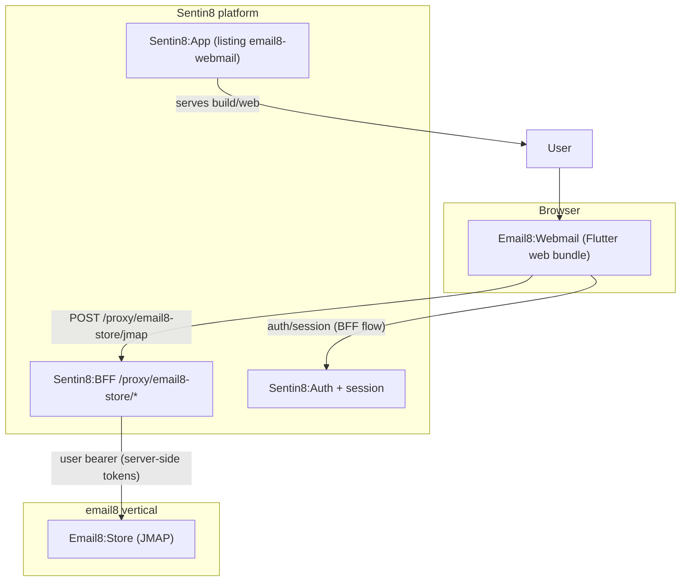
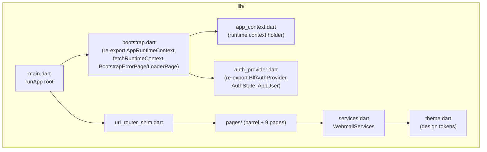
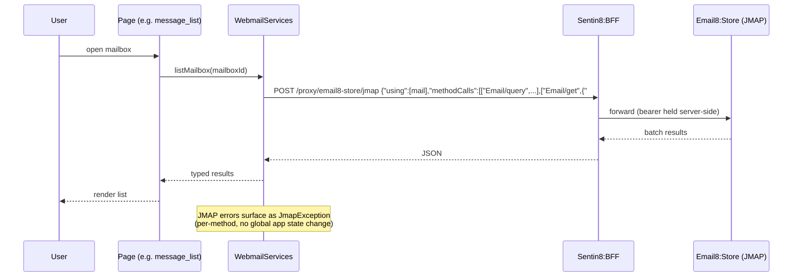
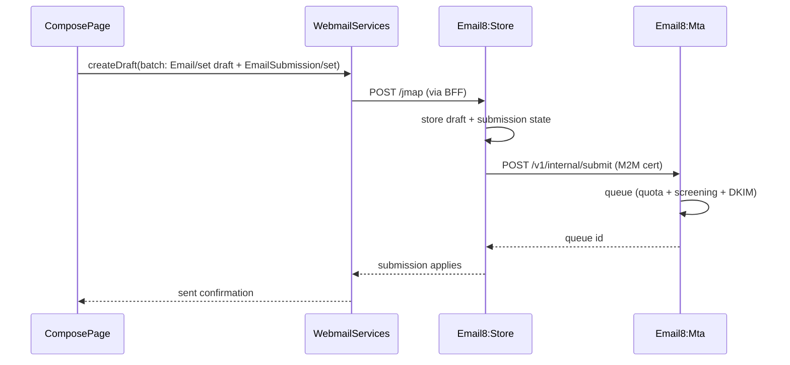
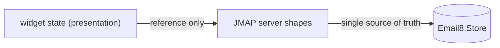
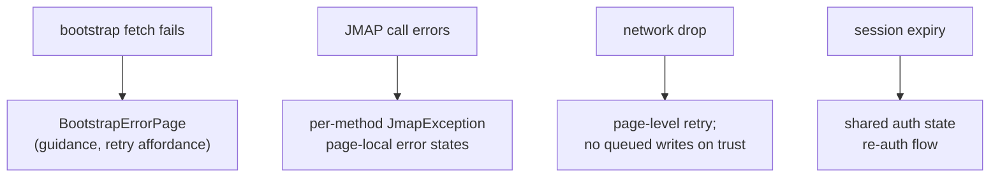
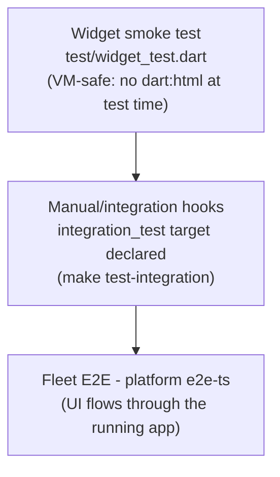

# Email8:Webmail - Detailed Design Document

## 1. Scope & Context

Email8:Webmail owns: the Flutter (Web) application bundle for
browser-based mail - pages, routing shim, theming shim, and the thin
JMAP-over-BFF service layer. It owns **no backend, no state of
record, and no protocol implementation of its own**.

It does NOT own: mail data (Email8:Store), session/auth mechanics
(shared `sentin8` Flutter package + Sentin8:BFF), token custody
(Sentin8:BFF), or hosting (platform app space; `build/web` is the
served artifact, registered via `service-registration.json`).

Trust boundary: the browser is untrusted. All bearer tokens live in
the BFF; the app never handles them (shared packages enforce this by
construction).

## 2. Runtime Architecture

The "runtime" is a Flutter widget tree plus two shared-system
integrations (auth provider and runtime bootstrap), re-exported rather
than reimplemented:

| Module | Responsibility |
|---|---|
| `main.dart` | app entry: installs the shared runtime (bootstrap → context → auth state) then `runApp` |
| `bootstrap.dart` | re-exports the platform bootstrap contract: `AppRuntimeContext`, `fetchRuntimeContext`, `BootstrapException`, `BootstrapErrorPage`, `BootstrapLoaderPage` (fail-fast config + branded loading/error UX) |
| `auth_provider.dart` | re-exports `BffAuthProvider`, `AuthState`, `AppUser` (`typedef AuthProvider = BffAuthProvider`) - session is BFF-hosted |
| `services.dart` | `WebmailServices` wraps `BffApiClient(bffBaseUrl, serviceName: 'email8-store', csrfToken, correlationId)`; a single client method `jmap(using, methodCalls)` posts to `/proxy/email8-store/jmap`; helpers build `Mailbox/get`, `Email/query`, `Email/get` batches; `JmapException` surfaces per-method JMAP errors |
| `pages/webmail_shell.dart` | app shell + navigation |
| `pages/landing_page.dart` | post-login landing |
| `pages/mailbox_list_page.dart` | folder tree via `Mailbox/get` |
| `pages/message_list_page.dart` | list via `Email/query` |
| `pages/message_detail_page.dart` | read via `Email/get` |
| `pages/compose_page.dart` | draft via JMAP then submit (`EmailSubmission` path through the store/MTA handoff) |
| `pages/search_page.dart` | server-side query filters |
| `pages/calendar_page.dart` | `CalendarEvent/get` |
| `pages/contacts_page.dart` | `ContactCard/get` |
| `pages/pages.dart` | barrel export |
| `theme.dart` | design-system tokens (shared package under the hood) |
| `url_router_shim.dart` | shallow URL routing shim honoring platform conventions |

**Page interaction (the canonical flow family):**

**Compose + send sequence (the mutation family):**

## 3. Data Model

The app has **no local data store of record**. Presentation state
lives in widget/state objects; all entities are JMAP server shapes:

| Concept | Source shape | Notes |
|---|---|---|
| Mailbox | `Mailbox` (JMAP) | id, name, role, unread counters |
| Message | `Email` (JMAP) | envelope, body, keywords, ids |
| Thread | `threadId` | grouping from Store |
| Identity | `Identity` | sender profiles for compose |
| Calendar event | `CalendarEvent` | calendar page |
| Contact | `ContactCard` | contacts page |
| Submission record | `EmailSubmission` | compose → send |

No database, no files, no browser storage of record (tokens never
arrive in the client by design).

## 4. API Surface

### 4.1 Outbound API consumption (the app's entire surface)

| Call | Target | Purpose |
|---|---|---|
| `POST /proxy/email8-store/jmap` | BFF → Store | every mail/groupware operation (single entry point) |
| Session/auth bootstrap | Shared BFF auth flow | sign-in state, user info |
| Runtime context fetch | Shared bootstrap | BFF base URL + app config |
| App bundle serving | Platform app hosting | `build/web` deployed from the listing |

JMAP method usage in the client: `Mailbox/get` (folders),
`Email/query` (lists/search), `Email/get` (read), `Email/set` +
`EmailSubmission/set` (compose/send), `CalendarEvent/get`,
`ContactCard/get`.

### 4.2 Registration surface (`service-registration.json`)

| Field | Value |
|---|---|
| Slug | `webmail` |
| Web dir | `build/web` |
| Listing name / slug | `Email8:Webmail` / `email8-webmail` |
| Visibility / status | `public` / `published` |
| Backend URL | metadata (`http://localhost:3010` at dev) |
| `supports_dcr` | `true` |
| Grant types | `authorization_code`, `refresh_token` |
| Response type | `code` |
| Token endpoint auth | `none` (public client, no secret) |
| Scopes | `openid, profile, email, email8:mail:read, email8:mail:write, email8:groupware:read, email8:groupware:write, storage:env:read, storage:env:write` |
| Consent | not required |

**Events emitted:** none. **Data model owned:** none (§3).

## 5. Cross-Cutting Concerns

- **Authentication (BFF pattern)**: tokens are minted and held in
  Sentin8:BFF; the browser session references the server session. The
  app consumes `AuthState` and never parses a token. CSRF + correlation
  ids ride the shared `BffApiClient`.
- **Authorization**: effective access equals the BFF session's scopes
  (`email8:mail:read/write`, groupware, storage); the UI derives
  affordances from state it can render, and the server re-checks every
  call client-side affordances can never widen access.
- **Error handling**: JMAP per-method errors surface as
  `JmapException` without poisoning app state; bootstrap failures use
  the shared `BootstrapErrorPage`.
- **Theming/branding**: tokens come from the design system via the
  shared package so tenant branding flows apply unmodified.
- **Build hygiene**: versioned builds (build-hash `SENTIN8_VERSION`
  dart-define), repo `.env` copied into the bundle for bootstrap.
- **No CORS/DAV concerns**: the app is browser-only over `/proxy/*`.

## 6. Failure Modes & Recovery

- Failed bootstrap: configuration errors fail fast with guidance
  rather than broken UI.
- Per-method JMAP errors never take down the shell - other pages keep
  working.
- No offline write queue: unsent drafts live in the server's Drafts
  mailbox, so a browser crash loses nothing authored server-side.

## 7. Concurrency & Performance Model

- Single-isolate Flutter web app; no background workers.
- JMAP batching (`Email/query` + `Email/get` with `#refs`) minimizes
  round trips per view.
- No local caching layer of record: correctness beats caching; the
  server's indexes are fast enough for lists via paged queries.
- One `BffApiClient` instance shared across pages (constant headers,
  connection reuse).

## 8. Invariants, Insecure-Defaults Rejected, Unsafe Rationale

- Zero token custody: no access/refresh token is ever stored,
  parsed, or logged in the client.
- All API paths go through `/proxy/email8-store/*` - direct service
  URLs are a rejected default.
- No client-side authorization decisions (server-side JMAP gates are
  the only authority).
- No secrets in the bundle (public-client OAuth, no client secret;
  dev `.env` carries only bootstrap config).
- No `unsafe`/FFI code; pure Dart/Flutter.

## 9. Testing Strategy

- The smoke test avoids web-only imports on the VM platform so
  `make test` runs on CI without a browser.
- Deep UI verification belongs to the platform e2e layer (real BFF +
  Store behind the app), matching the platform's testing strategy
  split.

## 10. Open Questions

- SSE/WebSocket push consumption in the client (Store exposes both;
  client UX currently refresh-driven).
- Mobile packaging targets (the shared SDK enables native builds; no
  native flavor ships today).
- Calendar/contact write UX (read basics only currently).

---

**Design attribution:** email8:webmail and its underlying concepts were designed by Hamid Jahanzad <Hamid@Jahanzad.com>.